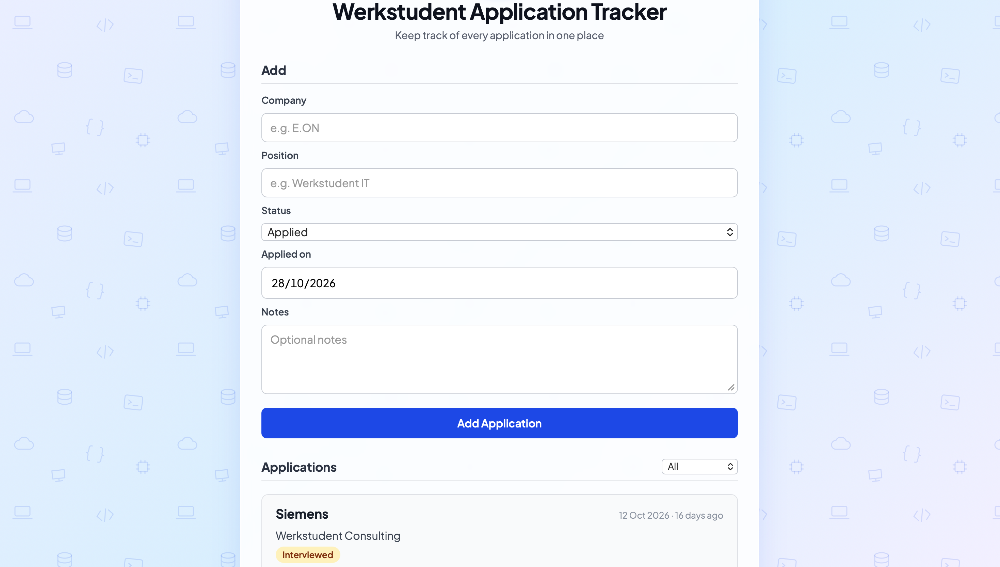

# Werkstudent Application Tracker

A small full-stack web app for keeping track of Werkstudent (working student) job applications in one place: which companies I applied to, for which position, and where each application currently stands.



## Features

- **Add, edit and delete applications** (company, position, status, notes)
- **Status tracking** with colour-coded badges: Applied, Interviewed, Rejected, Offer
- **Application date**: newest applications are shown first, with a "12 days ago" hint
- **Filter by status** to see, for example, only the applications that reached an interview
- **Input validation** on the backend: invalid data is rejected and the error is shown in the form
- **Data stays saved** after a restart, because it is stored in a local SQLite database
- **Responsive layout**, so it also works on small screens

## Tech Stack

| Layer    | Technology                                |
|----------|-------------------------------------------|
| Backend  | Python, FastAPI, Pydantic                 |
| Database | SQLite                                    |
| Frontend | HTML, CSS, vanilla JavaScript (Fetch API) |
| Server   | Uvicorn                                   |

## Getting Started

**Requirements:** Python 3.10 or newer

```bash
git clone https://github.com/<emncftci99>/werkstudent-application-tracker.git
cd werkstudent-application-tracker

python3 -m venv .venv
source .venv/bin/activate        # Windows: .venv\Scripts\activate

pip install -r requirements.txt
uvicorn main:app --reload
```

Then open <http://127.0.0.1:8000> in your browser.

The SQLite database (`application.db`) is created automatically the first time the app starts.

## API

FastAPI generates interactive documentation automatically at <http://127.0.0.1:8000/docs>.

| Method | Endpoint                  | Description                                    |
|--------|---------------------------|------------------------------------------------|
| GET    | `/applications`           | List all applications (optional `?status=...`) |
| GET    | `/applications/{id}`      | Get a single application                       |
| POST   | `/applications`           | Create an application                          |
| PUT    | `/applications/{id}`      | Update an application                          |
| DELETE | `/applications/{id}`      | Delete an application                          |

Allowed `status` values: `applied`, `interviewed`, `rejected`, `offer`.
`applied_date` is optional and uses the format `YYYY-MM-DD`.

## Project Structure

```
.
├── main.py            # FastAPI app: routes and validation
├── database.py        # SQLite connection and table setup
├── requirements.txt
└── frontend/
    ├── index.html
    ├── style.css
    ├── script.js      # Talks to the API with fetch()
    └── pattern.svg    # Background pattern
```

## What I Learned

- Building a REST API with FastAPI and validating input with Pydantic models and enums
- Writing parameterised SQL queries to prevent SQL injection
- Connecting a vanilla JavaScript frontend to a backend with the Fetch API
- Handling API errors (e.g. `422 Unprocessable Entity`) and showing them to the user
- Escaping user input before rendering it, to prevent XSS
- Debugging with the browser console, server logs and the auto-generated API docs

## Possible Next Steps

- Simple statistics (number of applications, interviews, offers)
- Automated API tests with `pytest`
